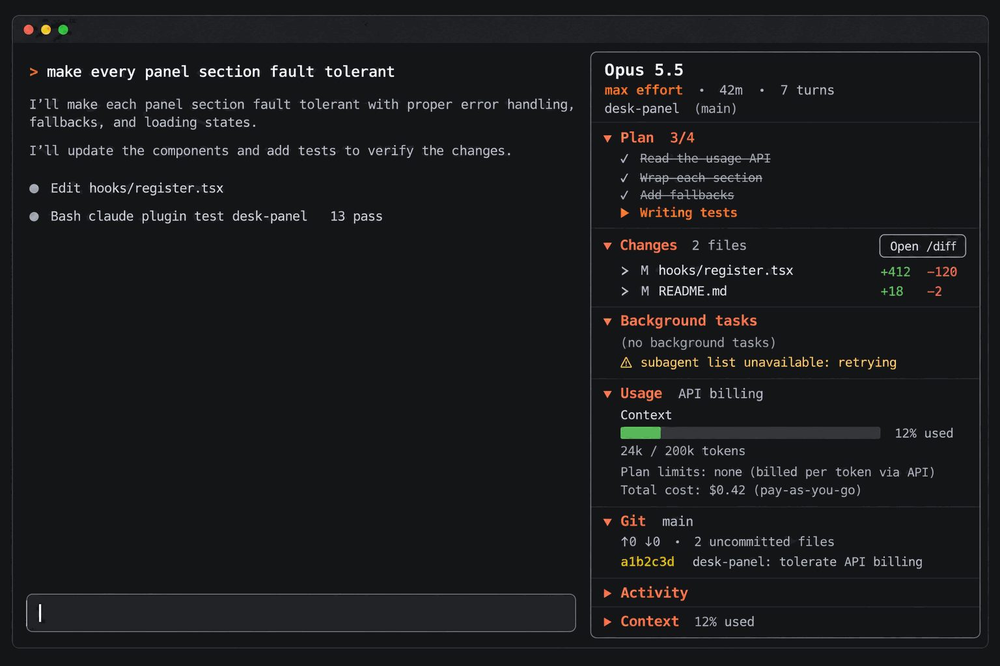

# desk-panel

English · [繁體中文](README.zh-TW.md)

A side panel for [Claude Code](https://code.claude.com/docs) in the terminal, laid out like the Claude desktop app's right-hand panel: the plan, the files Claude changed, background tasks and subagents, usage and git, in one pane you can act on. Expand a file to see its diff, jump to a subagent's transcript, or open `/diff`. Usage reads right on a subscription and on per-token billing (API key, Bedrock, Vertex, gateways), a failing data source affects only its own section, and while the panel is closed it polls nothing and runs no git.

This is an independent project, not affiliated with or endorsed by Anthropic.



<sub>Illustration generated with OpenAI gpt-image-2 (prompt in [`docs/desk-panel-prompt.txt`](docs/desk-panel-prompt.txt)), not a screenshot; the real panel differs in detail.</sub>

Type `/panel` and a panel titled *Session* opens beside the conversation, top to bottom:

| Section | Shows |
| --- | --- |
| Header | Model; reasoning effort of the latest request, time since the session started, turn count; current folder and branch |
| Plan | Todos from the TodoWrite and Task tools with progress (`2/5`); the plan approved through ExitPlanMode |
| Changes | Files Claude edited this session (`+added −removed`, how long ago), then other uncommitted files from git. Press a file to see its last diff; `Open /diff` opens the built-in diff view |
| Background tasks | Background shell commands, Monitor watches and subagents. Press a subagent to view its transcript |
| Usage | Context, *Current session*, *Current week* and *Spend limit* meters with reset times in the same format as `/usage`; estimated cost (see below) |
| Git | Branch, ahead/behind, number of uncommitted files, last commit or the commits made this session |
| Activity (collapsed by default) | Running tools with elapsed seconds, tools this turn, last turn's duration, per-tool counts and errors |
| Context (collapsed by default) | A `/context`-style bar and the largest categories with token counts |

Press a section title to fold or unfold it; the layout is remembered across sessions.

## Requirements

- Claude Code with the hooks-module plugin API. Tested with Claude Code 2.1.312. The API is early access and may change between releases, so a newer build may need an updated mod.
- Where it draws: in the fullscreen terminal layout the panel docks on the right (it asks for 52 columns; the engine keeps it between 24 columns and 45% of the terminal). Outside the fullscreen layout it appears above the prompt. The desktop app's Code tab draws it too.
- `git` on `PATH` for the Git section (otherwise the section shows git's own error).
- A terminal font with the usual box and arrow glyphs (`▾ ▸ ✓ ● █ ░ ⚠`).

## Install

In a terminal session, at the prompt:

```
/plugin install desk-panel --marketplace joshotws/desk-panel
```

From a shell:

```bash
claude plugin install desk-panel --marketplace joshotws/desk-panel
```

In the desktop app, where `/plugin` does not run: click **+** next to the prompt box, then **Plugins**, **Add marketplace** with `joshotws/desk-panel`, then **Add plugin**.

You will be asked `Add marketplace?` naming `github:joshotws/desk-panel` (answer `y`), then for a scope (user scope is first; press Enter). After `Installed desk-panel. Plugin is now active.` the mod runs in that session and in every later one.

## Commands and interactions

| Command | Effect |
| --- | --- |
| `/panel` | Open the panel. New sessions then open it automatically |
| `/panel close` | Close it and stop the automatic opening. Closing the pane yourself does the same |
| `/panel reset` | Default layout (Activity and Context folded, the rest open), warnings cleared, every source refreshed |
| `/panel size` | Report the panel's last drawn size, for troubleshooting |

If the terminal is too narrow when a session auto-opens the panel, the panel waits and is drawn once the window is wide enough, refreshing at that moment.

## Usage and cost

Subscription responses carry the five-hour and weekly windows, so the meters match `/usage`. With an API key, Bedrock, Vertex or a gateway that bills per token, responses carry no plan windows: the section is marked `API billing`, says `Plan limits: none (billed per token via API)`, and labels the cost `pay-as-you-go` (on a subscription it reads `API pricing`).

**`Total cost` is an estimate, not a bill.** It is Claude Code's own figure, the same one `/cost` shows: tokens per response times Anthropic's list prices. Through a gateway the gateway's own pricing applies. When Claude Code cannot price the model (for example a non-Claude model behind a gateway) the cost is zero or absent and the line is hidden.

Reset times use the en-US 12-hour format and your local time zone, as `/usage` does.

## What the mod writes and runs

Nothing leaves your machine: the mod makes no network requests and sends no telemetry.

- **Plugin store**: two keys (`autoOpen`, `collapsed`) in the plugin's own JSON file under Claude Code's configuration directory.
- **Flag file, optional**: `~/.claude/desk-panel/open/<session id>` containing `open` or `closed`, written only if you created the folder `~/.claude/desk-panel/open/` yourself (checked at session start and on `/panel`). See the next section. Home is `USERPROFILE` on Windows, `HOME` elsewhere.
- **git**, read-only, in the session's repository, each call with `--no-optional-locks` and a 5-second timeout: `status --porcelain=v1 -uall`, `rev-parse --abbrev-ref HEAD`, `rev-list --left-right --count @{upstream}...HEAD`, `diff HEAD --numstat`, `log -1`, `log --since=<session start>`, and `diff HEAD -- <file>` when you expand a file. At most 100 files are kept in state; the count stays exact.
- **While the panel is open**: usage, header and the subagent list are polled every 5 seconds; git runs about 2 seconds after an Edit, Write, NotebookEdit, Bash or PowerShell call finishes and at the end of each turn; the context breakdown at the end of each turn. **While it is closed** nothing polls and git never runs; tool calls, plan, changes, activity and background tasks are still tracked so the panel has the session's history when you open it.

## Optional: hide your status line while the panel is open

The panel repeats what a status line usually shows. If you want your status line to disappear while the panel is open, create the flag folder:

```bash
mkdir -p ~/.claude/desk-panel/open
```

From then on the mod writes `open` or `closed` to `~/.claude/desk-panel/open/<session id>`. Your status line command receives the session id in its JSON input, so it can exit early:

```bash
#!/bin/bash
input=$(cat)
id=$(printf '%s' "$input" | jq -r '.session_id')
[ "$(cat "$HOME/.claude/desk-panel/open/$id" 2>/dev/null)" = "open" ] && exit 0
# ... your status line below
```

The status line is not redrawn instantly: it disappears or returns on its next update. The files are never deleted (there is no delete API; a closed panel writes `closed`), so clear the folder whenever you like. Without the folder the mod writes nothing.

## Fault tolerance

- Each section fails on its own. A source that fails (usage, model name, subagent list, git, context breakdown) marks only its section with `⚠` and the reason; the last good data stays. Polled sources are marked only after two misses in a row, and the mark clears when they recover.
- If git cannot read the repository (not on `PATH`, timeout, `safe.directory`), the Git section shows git's own message; a diff that cannot be loaded says `(diff unavailable)`.
- A section that fails to draw (for example state left by an earlier version) shows `⚠ could not draw this section`; if the whole panel cannot be drawn, it shows the reason and how to recover (`/panel reset`, `/reload-plugins`).
- A button whose action fails explains in a toast; a failing `/panel` command replies with the reason.

## Development

The repository is a plugin marketplace with one plugin; the mod itself lives in [`desk-panel/`](desk-panel).

```bash
git clone https://github.com/joshotws/desk-panel
cd desk-panel
claude --plugin-dir ./desk-panel
```

Loading the mod from its folder in an interactive session writes the engine's API types to `desk-panel/.claude-plugin/types/` (git-ignored; `desk-panel/tsconfig.json` extends the `tsconfig.json` written there). Until that first load, the editor cannot resolve the `claude-code` module. Saving a file reloads the mod in that session. To run it as an installed plugin instead, add the clone as a marketplace (`claude plugin marketplace add /path/to/desk-panel`, then `claude plugin install desk-panel@desk-panel`): a folder marketplace is read in place, so edits apply after `/reload-plugins`.

Before a commit:

```bash
claude plugin validate desk-panel   # what the engine will refuse, and what the module hooks and calls
claude plugin test desk-panel       # desk-panel/tests/*.test.tsx against the engine
npx -p typescript tsc -p desk-panel # type-check hooks, types and tests
```

The engine's static scan requires `read($, atom)` and `update($, atom, ...)` to name the atom constant at the call site; do not wrap them in helpers. `desk-panel/types/index.d.ts` is the mod's state contract.

## Uninstall

Toggle it off in `/plugin`, or remove it:

```bash
claude plugin uninstall desk-panel@desk-panel
```

If you created the flag folder, delete `~/.claude/desk-panel/`.

## Known limitations

- The hooks-module API is early access; a Claude Code update can break the mod until it is updated.
- `git status -uall` lists every untracked file (ignored files excluded), which can be slow in a large untracked tree.
- File keys compare case-insensitively on Windows paths and case-sensitively elsewhere.
- Times are formatted en-US, as `/usage` does.

## Contributing

Issues and pull requests are welcome. Run `claude plugin validate`, `claude plugin test` and `tsc` before opening one. Code comments are in Traditional Chinese; English is fine for new ones.

## License and disclaimer

[MIT](LICENSE).

This is an independent project, not affiliated with or endorsed by Anthropic. Claude and Claude Code are trademarks of Anthropic, PBC. The panel's layout is modelled on the Claude desktop app's side panel. The illustration above, the GitHub social preview (`docs/social-preview.png`) and the plugin icon were generated with OpenAI gpt-image-2; their prompts are in [`docs/`](docs).
